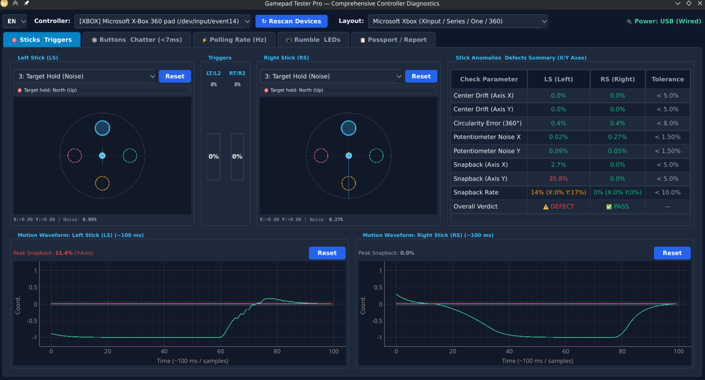
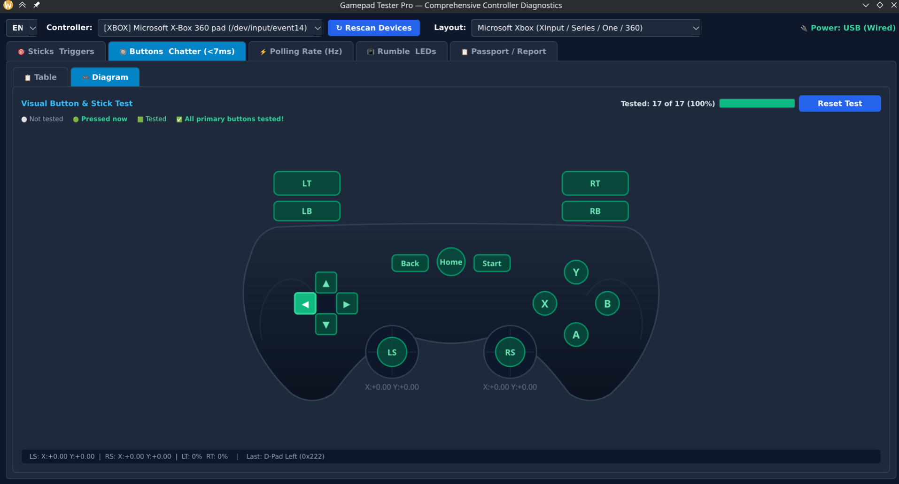
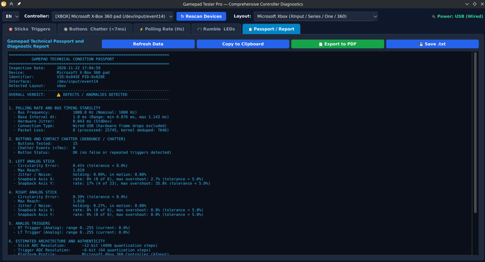
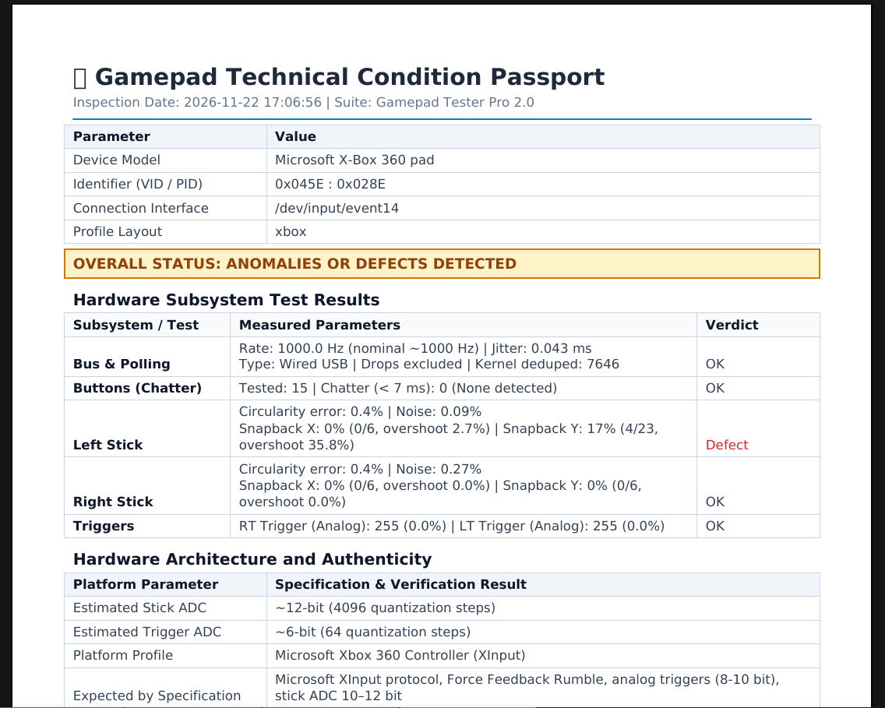

# Gamepad Tester Pro 🎮

Профессиональный программный комплекс для глубокого тестирования, калибровки и контроля качества игровых контроллеров в среде Linux.

Программа разработана для выявления аппаратных дефектов механики кнопок, потенциометров, магнитных датчиков (Hall Effect / TMR), центрирования стиков и шины опроса.

---

## 🚀 Основные возможности

### 1. Анализ аналоговых стиков (Thumbsticks)
* **Дрожание и шум (Jitter / Noise):** Измерение флуктуаций как во время движения (фильтрация полезного сигнала и расчёт 2-й производной шума), так и при удержании стика в отклонённом положении за пределами центральной мёртвой зоны.
* **Тест отскока (Snapback / Overshoot):** Автоматическая фиксация резкого отпускания стика из крайних положений. Фиксирует вылет в противоположную полуплоскость за ноль (амплитуда в % и время затухания).
* **Ошибка окружности (Circularity Error):** Расчёт отклонения траектории 360° от идеальной окружности с визуализацией краевых точек.
* **Центрирование:** Проверка возврата в ноль после отпускания.

### 2. Кнопки и детектор дребезга контактов (Contact Chatter)
* **Аппаратные тайминги ядра:** Использование микросекундных меток времени Linux Input Subsystem (`evdev`).
* **Детекция дребезга (< 7 мс):** Фиксация серий быстрых переключений `Нажато -> Отпущено -> Нажато`, указывающих на износ или загрязнение контактов механических свитчей.
* **Дескриптор и сопоставление:** Отображение сырого кода кнопки (Hex/Dec) и автоматическая проекция на раскладку контроллера.

### 3. Частота опроса и шина передачи (Polling Rate)
* Реальная частота пакетов в реальном времени (125 Гц, 250 Гц, 500 Гц, 1000 Гц).
* Дрожание интервалов опроса (Jitter / Standard Deviation в мс).
* Осциллограмма интервалов времени между пакетами ($\Delta t$) и счётчик пропусков.

### 4. Поддержка геймпадов и профилей раскладок
* **Sony DualSense (PS5) & DualShock 4 (PS4):** Поддержка RGB-подсветки (Lightbar), Player LEDs, чтение уровня заряда батареи, Force Feedback.
* **GP2040-CE (Raspberry Pi Pico / RP2040):** Полная поддержка 1000 Гц аркадных контроллеров и хитбоксов на механических кнопках.
* **Microsoft Xbox (XInput / Series / One / 360):** Вибромоторы, поддержка паттернов Ring of Light.
* **Автоматическое распознавание:** Различение профилей **Android AOSP HID** и **PC DirectInput (0x120)** с возможностью ручного переключения.

### 5. Паспорт геймпада и отчёты
* Формирование текстового отчёта с техническим вердиктом (Норма / Предупреждение / Брак).
* Экспорт в профессиональный **PDF-паспорт устройства** (на базе встроенного `QPdfWriter + QTextDocument`) для сервисных центров и контроля качества.

### 6. Справочник инженера и методика диагностики
* Подробное практическое руководство по физике узлов, интерпретации показателей, допускам и устранению аппаратных дефектов приведено в файле [HOWTO.md](HOWTO.md).

---

## 📦 Системные зависимости и установка

Подробный перечень пакетов для **Manjaro / Arch Linux** и **Debian / Ubuntu** приведён в файле [DEPENDENCIES.md](DEPENDENCIES.md).

### Быстрая установка в Manjaro / Arch:
```bash
sudo pacman -S python-pyside6
```

---

## 🛠 Запуск

Запуск графического интерфейса:
```bash
python3 main.py
# или
./run.py
```

Запуск быстрого CLI-сканирования подключенных контроллеров:
```bash
python3 main.py --cli
# или
python3 main.py --list
```

## 📽️ Скриншоты









## 🤔 Нескромное сравнение с другими проектами

Как это ни странно, но комплексных утилит для проверки геймпада почти нет, а то, что есть это плод ИИ, как собственно и этот проект. Почти всегда это Web сервисы, которые дают очень приблизительное понимание есть ли дефект и насколько он сильный. В общем-то этого обычно достаточно, чтобы понять надо ли ремонтировать или выбрасывать геймпад. Но если это надо выразить в цифрах, например при ремонте, то нет. Проблема всех без исключения Web сервисов это низкая скорость опроса устройства через целый ряд прослоек: драйвер -> sdl/xinput -> броузер. На каждом шаге есть задержки и потери. Моя утилита напрямую работает с драйвером получая все данные максимально быстро и точно. Побочным эффектом является жесткая привязка к Linux.

Наиболее близкая по функционалу утилита это [GamePadTester](https://github.com/deuxdoom/GamePadTester). Она вполне неплохо работает как в Linux, так и в Windows, собрана одним большим архивом и не нуждается в установке. Но в точности она проигрывает. Для Android/IOS [DriftPad](https://zydeno.com/apps/driftpad-gamepad-tester/). Ещё есть уже культовый набор [Gamepadla](https://gamepadla.com/uk/soft.pdl), там каждое действие в своей утилите. Всё. Остальное полный колхоз показывающий сферического коня в вакууме.

Насколько такая утилита нужна вопрос открытый. Мне она нужна для проверки своего странного самодельного геймпада [1 xbox](https://github.com/SerhiiLe/gamepadPicoXbox360) и [2 sony/nintendo/android](https://github.com/SerhiiLe/gamepadPicoGemini). Мне нужна была утилита, которая сможет адекватно показать что у меня получилось и сравнить с [GP2040-CE](https://gp2040-ce.info/) и заводскими устройствами.
